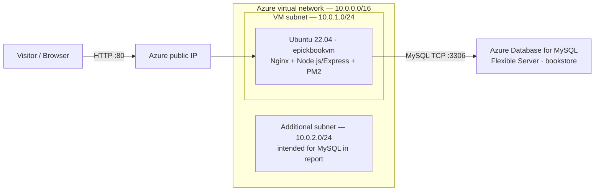
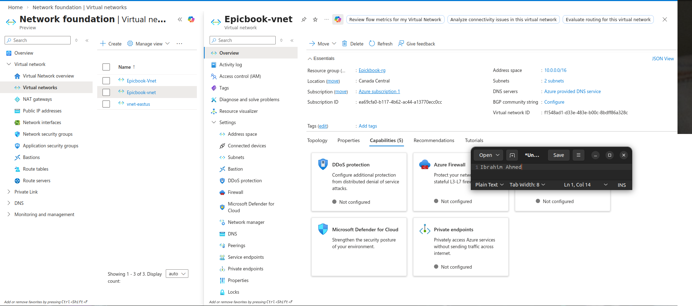
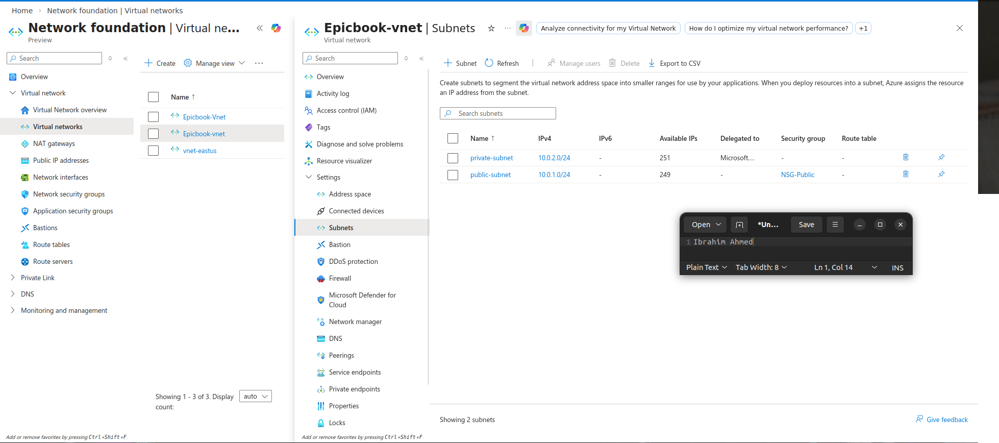
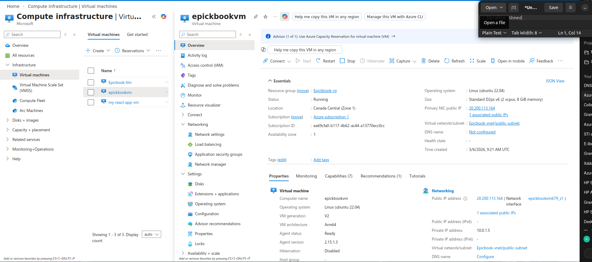
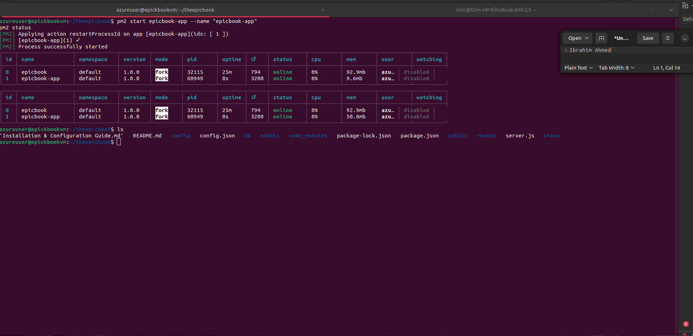
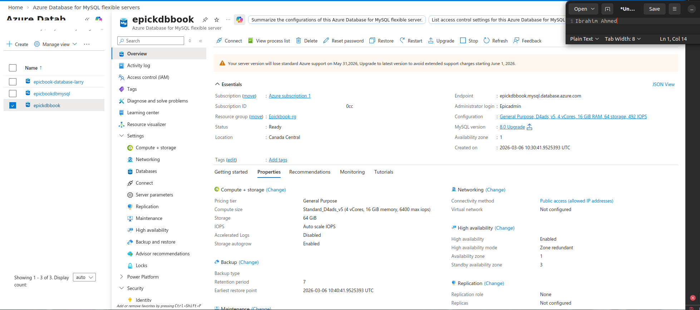
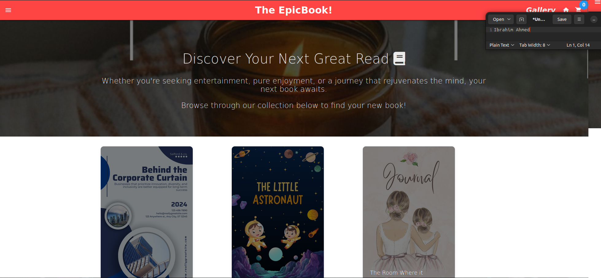

# Azure EpicBook — Monolithic Application Deployment

**DevOps Micro Internship (DMI), Cohort 2**

**Stack:** Microsoft Azure · Ubuntu 22.04 VM · Node.js/Express · Nginx · PM2 · Azure Database for MySQL Flexible Server

## Project overview

This project documents my deployment of **EpicBook**, an existing online bookstore application, on an **Azure Ubuntu virtual machine** with a managed **Azure MySQL** database. My work focused on Azure networking, VM preparation, application deployment, database setup, testing, and troubleshooting.

EpicBook is presented here as a **monolithic application**. Its application logic is deployed on one VM and the database is a separate managed service (**two infrastructure tiers**). This is **not** the Azure Three-Tier Book Review assignment.

- **My portfolio repository:** [slim274/azure-epicbook-monolithic-app](https://github.com/slim274/azure-epicbook-monolithic-app)
- **Original application / credit:** [pravinmishraaws/theepicbook](https://github.com/pravinmishraaws/theepicbook). I did not author the original application; my contribution is its **Azure deployment, configuration, testing, and documentation**.
- **Evidence source:** the Word report `IBRAHIM AHMED ABIODUN_Week8_GROUP2.docx`, *Assignment 3 only*, pages 23–33.

## Architecture (documented deployment)

The **written report** describes private VNet integration for MySQL, but the MySQL **screenshot** shows **“Public access (allowed IP addresses)”** and **“Virtual network: Not configured.”** For accuracy, the diagram does *not* place the database inside the VNet; private MySQL access is **not verified by the screenshots**. See [evidence limitations](docs/EVIDENCE_LIMITATIONS.md).

## Work completed 

| Task| Work recorded in the assignment |
|---|---|
| **1** | Created an Azure VNet (`10.0.0.0/16`), VM subnet (`10.0.1.0/24`), intended MySQL subnet (`10.0.2.0/24`), NSG rules, and a VM public IP. |
| **2** | Provisioned Ubuntu 22.04 VM `epickbookvm`; installed Node.js, npm, Nginx, Git, and MySQL client; configured PM2 and database access. |
| **3** | Forked/cloned EpicBook, installed dependencies, configured Nginx and Node.js/Express, and restarted the service with PM2. The report calls the frontend “React”; no separate React build is established by the screenshots. |
| **4** | Created an Azure MySQL Flexible Server and `bookstore` database, configured `epicbookadmin`, and reported importing SQL data. |
| **5** | Opened the app at its VM public IP, viewed books, and reported testing cart and orders. Only the website/book listing is shown in the supplied screenshot. |
| **6** | Published a LinkedIn assignment update. This is a submission record, not runtime infrastructure proof. |

## Screenshots from the original Word document

| Azure VNet | Subnets |
|:---:|:---:|
|  |  |

| Ubuntu VM | PM2 processes |
|:---:|:---:|
|  |  |

| Azure MySQL server | EpicBook website |
|:---:|:---:|
|  |  |

Additional NSG and public-IP screenshots are indexed in [screenshots/README.md](screenshots/README.md).

## Troubleshooting recorded

| Issue | Action described in the Week 8 report |
|---|---|
| MySQL authentication failed for `root@localhost` | Created a dedicated `epicbookadmin` account and updated app settings. |
| VM–MySQL connection/import issues | Updated networking and credentials; used the MySQL client to test connectivity. |
| Nginx pointed to the wrong frontend location | Updated the site configuration and reloaded Nginx. |
| PM2 did not use updated environment values | Ran `pm2 restart epicbook-app --update-env`. |
| TLS configuration difficulty | Report used `rejectUnauthorized: false` as a workaround; **this disables certificate verification and is not production-secure**. |

## Skills demonstrated

**Azure infrastructure provisioning · Azure Virtual Networks and subnetting · Network Security Groups · Azure Virtual Machines · Linux/Ubuntu administration · Node.js/Express deployment · Nginx reverse proxy configuration · PM2 process management · Azure MySQL Flexible Server · MySQL account management and database troubleshooting · Git/GitHub · technical documentation.**

## Documentation

- [Task-by-task Assignment 3 record](docs/ASSIGNMENT_3_REVIEW.md)
- [Deployment and verification notes](docs/AZURE_DEPLOYMENT.md)
- [Troubleshooting notes](docs/TROUBLESHOOTING.md)
- [Security and limitations](docs/EVIDENCE_LIMITATIONS.md)
- [Screenshot evidence index](screenshots/README.md)
- [Applying this package to the Git repository](docs/HOW_TO_UPDATE_EXISTING_REPOSITORY.md)

**Scope:** This repository documents a historical internship deployment. The screenshots do **not** establish HTTPS, production hardening, load balancing, automatic scaling, current uptime, successful SQL import output, or deployed private MySQL VNet integration.
